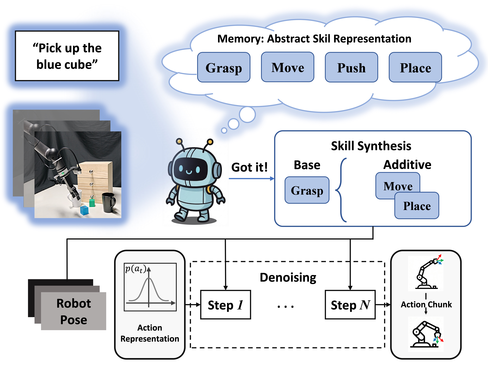

# SkillAttention

This repository contains the implementation of:

> ### [SkillAttention: Contextual Skill Synthesis for Long-Horizon Robotic Manipulation](https://dl.acm.org/doi/10.1145/3767308.3835253)
>
> Yonghuan Li, Yifan Wang, Qianfan Zhao, Fanghao Zhou, Xuxu Yang, Kai Liu, Xu Yang, Tiefeng Li
>
> ACM Multimedia 2026 (Oral)

## Overview of SkillAttention

<p align="center">
  
</p>

## Installation

### 1. Install MuJoCo 2.0

The LOReL simulation environment requires MuJoCo 2.0.

```bash
# Download and extract MuJoCo 2.0
mkdir -p ~/.mujoco
wget https://www.roboti.us/download/mujoco200_linux.zip
unzip mujoco200_linux.zip -d ~/.mujoco
mv ~/.mujoco/mujoco200_linux ~/.mujoco/mujoco200

# Download the activation key
wget https://www.roboti.us/file/mjkey.txt -O ~/.mujoco/mjkey.txt
cp ~/.mujoco/mjkey.txt ~/.mujoco/mujoco200/bin/

# Set environment variables
export LD_LIBRARY_PATH=$LD_LIBRARY_PATH:$HOME/.mujoco/mujoco200/bin
export MUJOCO_PY_MUJOCO_PATH=$HOME/.mujoco/mujoco200
export MUJOCO_PY_MJKEY_PATH=$HOME/.mujoco/mjkey.txt
```

Add the above environment variables to `~/.bashrc` to make
them persistent.

To verify the MuJoCo installation (requires a graphical display):

```bash
cd ~/.mujoco/mujoco200/bin
./simulate ../model/humanoid.xml
```

### 2. Setup Python Environment

Clone this repository:

```bash
git clone https://github.com/is-aHuan/SkillAttention.git
cd SkillAttention
```

Create a Conda environment and install the dependencies:

```bash
conda create -n skillattention python=3.10
conda activate skillattention

pip install -r requirements.txt
```

### 3. Install LOReL Environment

```bash
git clone https://github.com/suraj-nair-1/lorel.git

cd lorel/env
pip install -e .
```

## Dataset Preparation

### 1. Download LOReL Dataset

Download the original LOReL simulation dataset:

- [LOReL Official Repository](https://github.com/suraj-nair-1/lorel)
- [Dataset Download (Google Drive)](https://drive.google.com/file/d/1pLnctqkOzyWZa1F1zTFqkNgUzSkUCtEv/view?usp=sharing)

### 2. Data Preprocessing

Extract the downloaded dataset and convert the HDF5 data
into pickle format:

```bash
python h5py2pkl.py --root_path /path/to/may_08_sawyer_50k --output_name lorel_dataset.pkl
```

### 3. Dataset Configuration

Update the dataset path in
`src/conf/task/lorel_sawyer.yaml`
to point to the processed dataset.

## Training and Evaluation

Our implementation adopts a configuration-driven architecture.
Training and evaluation configurations are provided in `src/conf/`,
with task-specific configurations in `src/conf/task/`.

### Training

To train SkillAttention on the LOReL benchmark, run:

```bash
python src/workspace/main_hot.py --config-name=train_lorel_sawyer task=lorel_sawyer
```

Training hyperparameters can be modified in
`src/conf/train_lorel_sawyer.yaml`, while task-specific settings,
including the dataset path, can be modified in
`src/conf/task/lorel_sawyer.yaml`.

### Evaluation

To evaluate a trained model on the LOReL benchmark, run:

```bash
python src/workspace/eval.py --config-name=train_lorel_sawyer task=lorel_sawyer checkpoint=/path/to/checkpoint
```

## Real-World Experiments

Our real-world experiments are conducted on a RealMan robotic arm.

### Data Collection

Expert demonstrations are collected via a Quest 3-based teleoperation system.
For the teleoperation implementation and data collection instructions,
please refer to [Quest3-Teleoperation](https://github.com/is-aHuan/Quest3-Teleoperation).

### Real-World Datasets

We publicly release our real-world manipulation datasets on Hugging Face
in two formats:

| Dataset | Format | Download |
| :--- | :---: | :---: |
| RealMan | Pickle (`.pkl`) | [Hugging Face](https://huggingface.co/datasets/yonghuanli/realman_all) |
| SkillAttention | LeRobot | [Hugging Face](https://huggingface.co/datasets/yonghuanli/SkillAttention) |

## Citation

If you find our work useful, please consider citing:

```bibtex
@inproceedings{SkillAttention,
title = {SkillAttention: Contextual Skill Synthesis for Long-Horizon Robotic Manipulation},
author = {Li, Yonghuan and Wang, Yifan and Zhao, Qianfan and Zhou, Fanghao and Yang, Xuxu and Liu, Kai and Yang, Xu and Li, Tiefeng},
booktitle = {Proceedings of the 34th ACM International Conference on Multimedia},
year = {2026}
}
```

## Acknowledgements

We thank the authors of [LOReL](https://github.com/suraj-nair-1/lorel)
for releasing their code and dataset.